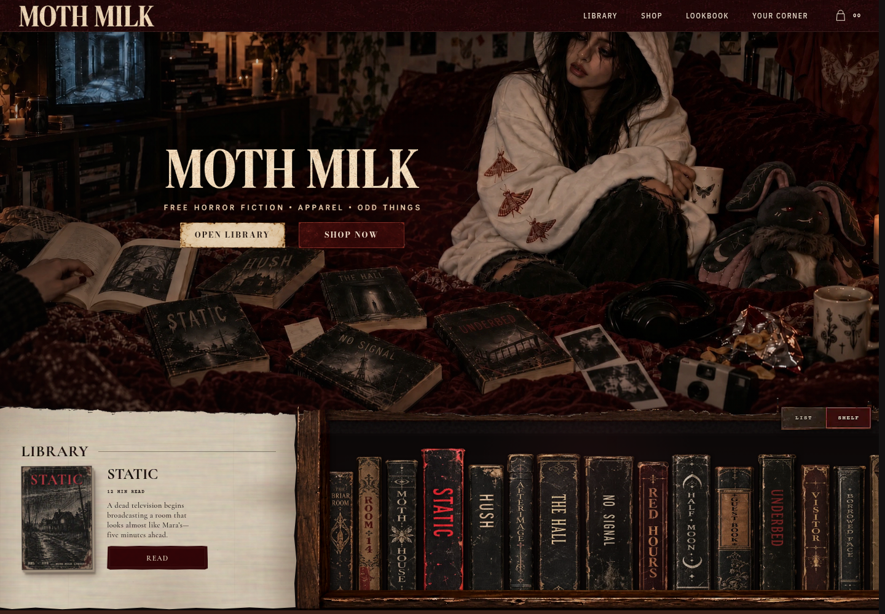
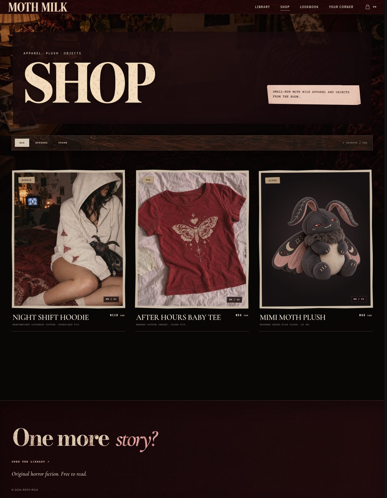
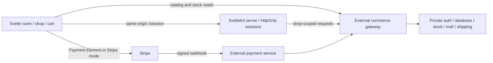

# Moth Milk

An after-hours room for horror excerpts, soft goods and the things a reader keeps. The storefront pairs photographed rooms, cloth-and-paper surfaces, a browsable bookshelf and a personal “Your Corner” with a cart and recoverable checkout.

Built with **Svelte 5, SvelteKit 2, TypeScript and SCSS**, using self-hosted Fontsource typography, Stripe Payment Element and the Vercel server adapter. The private commerce backend is external; this repository contains the interface, SSR account pages and restricted session/checkout proxy.



| The room on mobile | The shop on desktop |
| --- | --- |
|  |  |

These are actual Chromium renders. Home screenshots are anonymous; shop data is a synthetic catalog. External browser requests are blocked during capture. Artwork rights also apply to screenshots; see [asset inventory and owner decisions](docs/ASSET-RIGHTS.md).

## Run the local rehearsal

Use Node **22.18+** and the locked dependencies:

```sh
npm ci
npm run demo
```

Open `http://127.0.0.1:4173`. The page labels this as the rehearsal room. The loopback fixture supplies a synthetic catalog, stock, accounts and orders; test checkout never loads Stripe or moves money. Use `reader@example.test` and invented address details. Fixture state is disposable and is not a database or authentication implementation. UI/backend ports are 4173/4174; startup fails if those ports are occupied. Stop with Ctrl+C. No private service, credentials or `.env` are needed, and the launcher overrides shop/origin/payment settings for its child processes.

The ordinary `npm run dev` path retains the existing real-backend integration. With no backend configured, the visual room/library still renders; commerce/account requests fail safely with an unavailable message. Nothing is silently treated as a successful order.

## How the pieces connect



In rehearsal, the local fixture replaces the gateway and payment response; it does not emulate a real Stripe integration. In ordinary Stripe mode, a browser payment result alone cannot confirm an order: the application waits for backend confirmation and preserves uncertain attempts rather than inviting another payment.

## What works, and where

| Feature | In this repository | Verification / external requirement |
| --- | --- | --- |
| Responsive room, bookshelf, story reader, product pages, bag and navigation | Real components, SCSS, artwork and interactions | Desktop/mobile Chromium scenarios; stories are descriptions/excerpts, not claimed full-length novels |
| Your Corner books and owned-item presentation | UI, state and SSR loading | Fixture coverage; real persistence/ownership needs customer and order services |
| Registration, login, verification and password recovery | Account UI and restricted cookie proxy | Fixture coverage; real identity validation, email delivery and revocation need private services |
| Checkout, receipt history, status, resume and safe cancellation | Real storefront logic with original-attempt recovery | Simulated orders in rehearsal; real Stripe/account/webhooks/stock/fulfillment remain external |
| Payment/stock/tax authority, database and migrations | Not included | Private backend must enforce prices, tenant isolation, ownership, idempotency and payment authorization |

The rehearsal deliberately accepts fake account details and returns fixture order data. Passing it is not evidence of a functioning mail server, real card payment, refund or shipment. EN/FR/ES account landing routes exist; the visible storefront copy is currently English.

## Connect a disposable backend

```sh
cp env.example .env
# Edit .env for your own disposable shop and test backend.
npm run dev
```

| Setting | Purpose |
| --- | --- |
| `PUBLIC_API_URL` | Browser-reachable HTTP(S) gateway origin; no path, embedded credentials, query or fragment |
| `API_ORIGIN` | Private server-to-server gateway origin; defaults to the public API origin |
| `PUBLIC_SHOP_ID` | Existing shop UUID, or empty only if the gateway resolves this exact storefront host |
| `PUBLIC_PAYMENT_MODE` | `stripe` for the normal integration; `stub` only with a loopback test upstream |
| `PUBLIC_STRIPE_PUBLISHABLE_KEY` | Publishable key matching the intended Stripe environment; use `pk_test_…` for disposable test resources |

The gateway contracts are in `src/lib/types/api.ts`. They cover products/stock, shop-bound customer sessions/books, order preparation/status/resume/cancel, history and claims. Database schema, private source, deployment provisioning and identity migrations are not included.

All `PUBLIC_*` values are browser-visible. Build and request guards permit only the four documented public names. Never put backend credentials, receipt capabilities, Stripe secret/webhook keys or mail credentials there. A backend key cannot switch a configured test Stripe client to live mode. Backend authorization still controls orders and payments; browser checks are not a security authority. Existing live-mode support and production settings are unchanged.

## Verify locally

```sh
npm run check
npm test
npm run build
npx playwright install chromium
npm run test:e2e
npm run test:e2e:boundaries
npm run test:e2e:demo
npm audit
```

Run build/browser commands sequentially: they share generated SvelteKit output. The main suite starts a production preview plus disposable local upstream; some scenarios intercept browser API/Stripe, and security scenarios exercise the real cookie proxy. Boundary tests build without a backend; rehearsal tests complete only a local synthetic order. Projects cover desktop Chrome and Chromium with iPhone 13 settings, not mobile Safari. No live smoke test is part of these commands. [Verification evidence](docs/VERIFICATION.md) records actual counts, dependency advisories and CI status.

To recreate screenshots while the controlled preview is running on 4173, use `node scripts/capture-portfolio.ts`. Set `PLAYWRIGHT_CHROMIUM_EXECUTABLE_PATH` when using a system browser. Capture blocks external browser requests and uses synthetic data.

## Server and security boundaries

This is **not a static export**: `/session`, customer SSR and checkout recovery require a SvelteKit server. `svelte.config.ts` uses `@sveltejs/adapter-vercel`, and prerendering is disabled. Stale static hosting metadata was removed in Pass 1; no hosting project was changed. A successful local build does not authorize or perform a deployment.

Session tokens use host-only HttpOnly cookies; sensitive responses are private/no-store. The proxy limits routes/methods, requires same-origin mutations and sets server-controlled shop scope. The backend must validate sessions, capabilities, tenant ownership and payment state. Unfinished recovery keys remain browser-accessible; submitted contact data has tab/cookie recovery retention. SHA-256 fingerprints remove plaintext contact duplication, not all privacy risk.

See the [security boundary matrix](docs/SECURITY-BOUNDARIES.md) for storage, URLs/logging, CSP, backend assumptions and remaining risks. [Implementation notes](docs/IMPLEMENTATION.md) cover detailed checkout/account behavior and guarded integration utilities; they are not live-backend certification.

## Review and reuse status

The repository is already public. This PR changes neither visibility nor production. **Portfolio rights clearance remains NO-GO** until the owner confirms artwork/story origins, attribution and code-license scope. Fontsource and the bundled Cormorant derivative have concrete OFL evidence and retained notices. No open-source license has been invented for project code or creative assets.

Start with the [Pass 2 review and focused owner decisions](docs/PASS-2-REVIEW.md), [exact asset/story/dependency inventories](docs/ASSET-RIGHTS.md), and [historical publication audit](docs/PUBLICATION-REVIEW.md).
